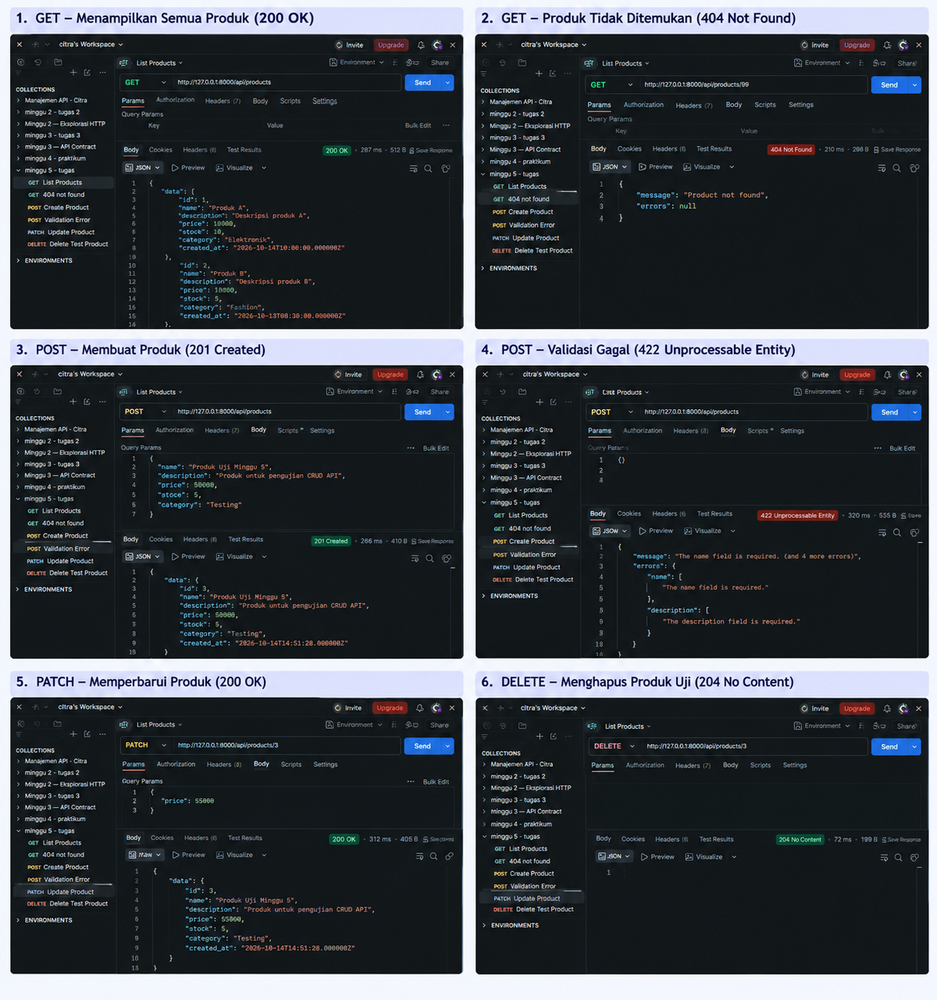

# Tugas 5 — CRUD Resource Utama

## 1. Tujuan

Tugas ini bertujuan menerapkan operasi CRUD (Create, Read, Update, Delete) pada REST API menggunakan Laravel. Implementasi mencakup validasi data, API Resource, error response, serta pengujian endpoint menggunakan Postman dan pengujian otomatis.

## 2. Perubahan yang Dilakukan

Perubahan pada project meliputi:

- Menambahkan operasi CRUD pada `ProductController`.
- Menggunakan `StoreProductRequest` untuk memvalidasi data produk baru.
- Menggunakan `UpdateProductRequest` untuk memvalidasi pembaruan data produk.
- Menggunakan `ProductResource` agar struktur response produk konsisten.
- Menambahkan error response untuk produk yang tidak ditemukan.
- Menguji endpoint menggunakan Postman.
- Menjalankan pengujian otomatis menggunakan Pest.

Atribut produk yang digunakan adalah `name`, `description`, `price`, `stock`, dan `category`.

## 3. Endpoint dan API Contract

| Method | Endpoint | Fungsi | Status |
|---|---|---|---|
| GET | `/api/products` | Menampilkan semua produk | 200 OK |
| GET | `/api/products/{product}` | Menampilkan detail produk | 200 OK |
| POST | `/api/products` | Membuat produk | 201 Created |
| PATCH | `/api/products/{product}` | Memperbarui sebagian data produk | 200 OK |
| DELETE | `/api/products/{product}` | Menghapus produk | 204 No Content |

Response sukses untuk menampilkan dan memperbarui produk menggunakan key `data`. Response pembuatan produk juga menggunakan key `data`.

Untuk produk yang tidak ditemukan, API mengembalikan status `404 Not Found` dengan format:

```json
{
  "message": "Product not found",
  "errors": null
}
```

## 4. Validasi Data

Validasi dilakukan menggunakan Form Request.

Aturan validasi meliputi:

- `name`: wajib diisi, berupa string, maksimal 255 karakter.
- `description`: wajib diisi dan berupa string.
- `price`: wajib diisi, numerik, dan minimal 0.
- `stock`: wajib diisi, bilangan bulat, dan minimal 0.
- `category`: wajib diisi, berupa string, maksimal 255 karakter.

Pada operasi PATCH, field yang tidak dikirim tidak harus diperbarui. Jika data yang dikirim tidak memenuhi aturan validasi, API mengembalikan status `422 Unprocessable Entity`.

## 5. Bukti Pengujian Postman

Gambar berikut berisi bukti pengujian endpoint CRUD, termasuk response sukses dan error response.



Hasil pengujian yang diperoleh:

| Pengujian | Hasil |
|---|---|
| GET semua produk | 200 OK |
| GET produk tidak ditemukan | 404 Not Found |
| POST membuat produk | 201 Created |
| POST dengan data kosong | 422 Unprocessable Entity |
| PATCH memperbarui harga produk uji | 200 OK |
| DELETE produk uji | 204 No Content |

## 6. Pengujian Otomatis

Pengujian otomatis dijalankan menggunakan perintah:

```bash
php artisan test --compact
```

Hasil pengujian yang diperoleh:

- 12 pengujian berhasil.
- 38 assertions berhasil.
- Tidak ada pengujian yang gagal.

## 7. Error Case

Error case yang diuji meliputi:

1. Produk dengan ID yang tidak ditemukan menghasilkan `404 Not Found`.
2. Data produk kosong saat POST menghasilkan `422 Unprocessable Entity`.
3. Harga negatif saat PATCH menghasilkan `422 Unprocessable Entity`.

Error response membantu client memahami penyebab kegagalan request.

## 8. Kesimpulan

Implementasi CRUD REST API Product telah mencakup proses membaca, membuat, memperbarui, dan menghapus data produk. Validasi menggunakan Form Request, struktur response menggunakan API Resource, dan error response digunakan untuk menangani data tidak valid atau produk yang tidak ditemukan.

Pengujian melalui Postman dan Pest digunakan untuk memeriksa kesesuaian implementasi dengan API contract.

## 9. Referensi

1. Dokumentasi Laravel — Validation: https://laravel.com/docs/validation
2. Dokumentasi Laravel — Eloquent Resources: https://laravel.com/docs/eloquent-resources
3. Dokumentasi Laravel — Testing: https://laravel.com/docs/testing
4. API contract project pada dokumentasi praktikum Minggu 3.

## 10. Deklarasi Penggunaan AI

membantu untuk menjelaskan struktur yang kurang dipahami. 