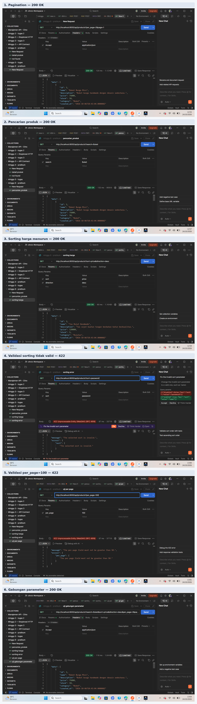

# Praktikum 6 — Endpoint Collection yang Dapat Dicari

## 1. Tujuan
Menambahkan fitur pagination, pencarian, sorting, dan validasi parameter pada endpoint `GET /api/products`.

## 2. Implementasi
Fitur diterapkan pada method `index()` di `ProductController.php`, meliputi:
- Pagination dengan default 5 produk dan maksimal 50 produk per halaman.
- Pencarian berdasarkan nama (`name`) dan kategori (`category`).
- Sorting berdasarkan kolom yang diizinkan.
- Validasi parameter `search`, `sort`, `direction`, `page`, dan `per_page`.
- Respons pagination berisi `data`, `links`, dan `meta`.

## 3. Hasil Pengujian
Pengujian dilakukan menggunakan Postman dengan header `Accept: application/json`.

| No. | Skenario | Hasil |
|---|---|---|
| 1 | Pagination (`per_page=2&page=1`) | 200 OK |
| 2 | Pencarian (`search=Buket`) | 200 OK |
| 3 | Sorting harga menurun | 200 OK |
| 4 | Sorting tidak valid (`sort=password`) | 422 |
| 5 | Batas halaman (`per_page=100`) | 422 |
| 6 | Kombinasi pencarian, sorting, dan pagination | 200 OK |

## 4. Pengujian Otomatis
Pemeriksaan sintaks PHP berhasil. Pengujian Laravel menghasilkan 12 tes berhasil dengan 38 assertions.

## 5. Kesimpulan
Endpoint Products berhasil dilengkapi dengan pagination, pencarian, sorting, dan validasi parameter. Pengujian Postman menunjukkan respons berhasil untuk parameter yang valid dan respons 422 untuk parameter yang tidak valid.

## 6. Bukti Pengujian
