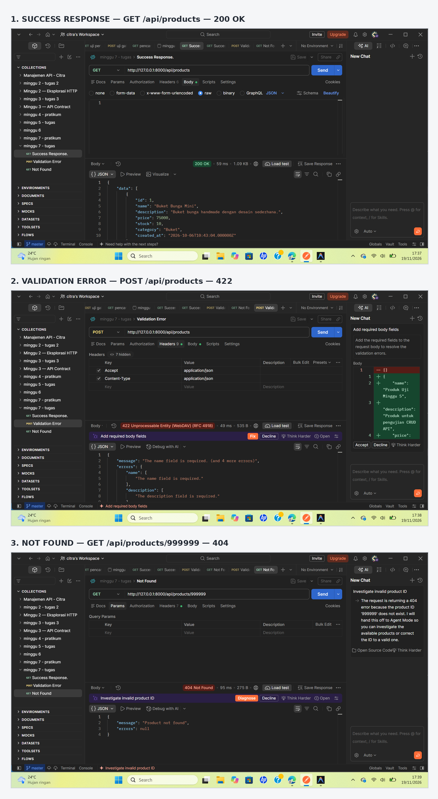

# Tugas 7 — Test Suite dan Dokumentasi API

## 1. Tujuan

Tugas ini bertujuan menerapkan testing dan dokumentasi API pada project semester menggunakan Laravel. Pengujian dilakukan untuk memastikan setiap endpoint berjalan sesuai API contract, baik pada kondisi berhasil maupun ketika terjadi kesalahan. Selain itu, Postman Collection dan dokumentasi diperbarui agar hasil implementasi dapat diuji dan diverifikasi.

## 2. Perubahan

Project menggunakan Laravel dengan fitur Product API.

Perubahan dan kegiatan yang dilakukan:

1. Memeriksa endpoint Product API yang tersedia.
2. Menjalankan Feature Test menggunakan Pest.
3. Menguji skenario keberhasilan, validasi, dan data tidak ditemukan.
4. Membuat Postman Collection baru bernama `minggu 7 - tugas`.
5. Menambahkan tiga request untuk menguji success response, validation error, dan not found.
6. Memperbarui dokumentasi hasil pengerjaan.

## 3. Endpoint atau API Contract

Endpoint Product API yang tersedia:

| Method | Endpoint | Fungsi |
|---|---|---|
| GET | `/api/products` | Menampilkan seluruh produk |
| POST | `/api/products` | Menambahkan produk |
| GET | `/api/products/{product}` | Menampilkan detail produk |
| PATCH | `/api/products/{product}` | Memperbarui produk |
| DELETE | `/api/products/{product}` | Menghapus produk |

Data produk memiliki field:

- `id`
- `name`
- `description`
- `price`
- `stock`
- `category`
- `created_at`

Response data produk menggunakan format JSON dengan pembungkus `data`.

Pada endpoint penambahan produk, field `name`, `description`, `price`, `stock`, dan `category` wajib diisi sesuai aturan validasi.

## 4. Bukti Pengujian

### A. Feature Test

Pengujian dilakukan menggunakan perintah:

`php artisan test tests/Feature/ProductApiTest.php`

Hasil pengujian:

- Tests: 10 passed
- Assertions: 36
- Status: Passed

Pengujian seluruh test suite dilakukan menggunakan:

`php artisan test`

Hasil pengujian:

- Tests: 12 passed
- Assertions: 38
- Status: Passed

### B. Pengujian Postman

Pengujian dilakukan menggunakan collection `minggu 7 - tugas`.

| Skenario | Method | Endpoint | Hasil |
|---|---|---|---|
| Success Response | GET | `/api/products` | 200 OK |
| Validation Error | POST | `/api/products` | 422 Unprocessable Entity |
| Not Found | GET | `/api/products/999999` | 404 Not Found |

**1. Success Response**

Request menggunakan GET `/api/products`.

Hasil pengujian menunjukkan status `200 OK`. API berhasil menampilkan daftar produk dalam format JSON dengan properti `data`.

**2. Validation Error**

Request menggunakan POST `/api/products` dengan body JSON kosong:

`{}`

Hasil pengujian menunjukkan status `422 Unprocessable Entity`. API menolak data karena lima field wajib belum diisi, yaitu `name`, `description`, `price`, `stock`, dan `category`.


**3. Not Found**

Request menggunakan GET `/api/products/999999`.

Hasil pengujian menunjukkan status `404 Not Found` dengan response:

```json
{
  "message": "Product not found",
  "errors": null
}
```

API memberikan respons bahwa produk dengan ID tersebut tidak ditemukan.


## 5. Error Case

Error case yang diuji meliputi:

1. Data produk tidak memenuhi validasi menghasilkan HTTP 422.
2. Produk dengan ID yang tidak tersedia menghasilkan HTTP 404.
3. Pembaruan produk yang tidak ditemukan menghasilkan HTTP 404.
4. Penghapusan produk yang tidak ditemukan menghasilkan HTTP 404.

Pengujian tersebut memastikan API dapat menangani permintaan yang tidak valid atau data yang tidak tersedia dengan status code dan response yang sesuai.

## 6. Kesimpulan

Pengujian Product API telah dilakukan melalui Feature Test dan Postman. Feature Test berhasil dijalankan dengan 10 pengujian lulus dan 36 assertions. Seluruh test suite juga berhasil dengan 12 pengujian lulus dan 38 assertions.

Pengujian Postman menunjukkan bahwa endpoint dapat memberikan respons sukses `200 OK`, menangani kesalahan validasi `422 Unprocessable Entity`, serta memberikan respons `404 Not Found` ketika produk tidak ditemukan.

Hasil pengujian menunjukkan bahwa implementasi API telah menangani skenario yang diuji sesuai dengan API contract. Dokumentasi dan Postman Collection juga telah disiapkan sebagai bukti verifikasi.

## 7. Referensi

1. Materi 7 — Testing dan Dokumentasi API.
2. Praktikum 7 — Feature Test dan Postman Collection.
3. Dokumentasi Laravel 13 — Testing: https://laravel.com/docs/13.x/testing
4. Dokumentasi Postman — Collections: https://learning.postman.com/docs/collections/collections-overview/

## 8. Deklarasi Penggunaan AI

AI digunakan sebagai alat bantu untuk memahami materi, memberikan arahan teknis.

### 9. Bukti Pengujian
Bukti pengujian menggunakan Postman disimpan pada file `bukti-pengujian-minggu-7.png` di folder `docs`  
